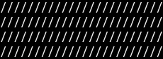

# Zellij Slashes Pane

> [!TIP]
> This template is a starting point you can use for every Zellij plugin. We offer:
>
> * Clear structure and quick notes
> * Install/upgrade instructions which allow your customers to avoid compiling
> * Continuous integration to [check formatting](.github/workflows/lint.yml) and [build and test](.github/workflows/build-test.yml)
> * A render snapshot checked by [tests/snapshot.sh](tests/snapshot.sh), using [Zellij Plugin Snapshot](https://github.com/fulldecent/zellij-plugin-snapshot)
> * Automated releases with [Release Please](.github/workflows/release.yml) and SLSA provenance attestation
> * A shared [Rust toolchain](rust-toolchain.toml) for local development and CI
> * A minimal implementation to extend, which is suitable for every plugin type (status bar, tab bar, pane, floating pane)
>
> If a more specific template applies, use that instead:
>
> * [project-template](https://github.com/fulldecent/project-template): any project
> * [rust-template](https://github.com/fulldecent/rust-template): Rust applications and libraries
>
> What is in-scope for this template?
>
> We the people who manage Zellij plugins, in order to advocate for a safer installation path and great defaults, maintain this starting point for plugin projects.
>
> This zellij-plugin-template must remain broad—addressing the needs of many kinds of Zellij plugins. Every project deserves a README, and a clear rule on basic formatting questions, this is why we include continuous integration linting.
>
> We do not specify that GitHub and GitHub Actions are the only way to host projects, others may consider our GitHub-specific notes as a starting point guide for implementing outside of GitHub.
>
> And now below is the template, shown for a specific hypothetical project, enjoy!

[](https://github.com/fulldecent/zellij-plugin-template/actions/workflows/lint.yml) [](https://github.com/fulldecent/zellij-plugin-template/actions/workflows/build-test.yml)

A Zellij pane filled with slash characters. It needs no permissions. It is just slashes.

Zellij Slashes Pane offers:

* A wasm you can drop into `~/.config/zellij/plugins` without compiling
* A stable reverse-DNS file name so upgrades overwrite the same path
* A signed sidecar that records the release version



This is a [Zellij](https://zellij.dev/) plugin and supports the latest active release of Zellij.

> [!NOTE]
> After you use the template, replace "Zellij Slashes Pane" and the sentence above with what your project does, and the badge URL. If you can, include screenshots/graphics to fill in that placeholder. Because you have just six seconds to pique a person's interest!
>
> Also update the reverse-DNS plugin file name (`com.github.fulldecent.zellij-plugin-template.wasm`) to match your GitHub owner and repository, and the description in Cargo.toml.

## Try it out

1. Select the latest wasm release and install to your plugins folder:

   ```sh
   name="com.github.fulldecent.zellij-plugin-template.wasm"
   base="https://github.com/fulldecent/zellij-plugin-template/releases/latest/download"
   mkdir -p ~/.config/zellij/plugins
   curl -fL -o ~/.config/zellij/plugins/"$name" "$base/$name"
   curl -fL -o ~/.config/zellij/plugins/"${name}.sigstore.jsonl" "$base/${name}.sigstore.jsonl"
   ```

   If you have the `gh` command, verify the file build attestation:

   ```sh
   gh attestation verify ~/.config/zellij/plugins/"$name" \
     -R fulldecent/zellij-plugin-template \
     --bundle ~/.config/zellij/plugins/"${name}.sigstore.jsonl"
   ```

2. Start a new session (or tab if already in Zellij). This does not edit `config.kdl`:

   ```sh
   zellij --layout-string 'layout {
       pane size=1 borderless=true {
           plugin location="tab-bar"
       }
       pane {
           plugin location="file:~/.config/zellij/plugins/com.github.fulldecent.zellij-plugin-template.wasm"
       }
       pane size=1 borderless=true {
           plugin location="status-bar"
       }
   }'
   ```

## Installation

Use [Try it out](#try-it-out) to download the plugin.

This pane is not a stock alias. Open it with the layout above. To upgrade: repeat [Try it out](#try-it-out) step 1, then start a new session.

> [!NOTE]
> If your project requires some installation process to use it, explain that here. If not, delete this section.
>
> Other common names for this section include: getting started, setup.
>
> A plugin that replaces `tab-bar` or `status-bar` is installed in `~/.config/zellij/config.kdl`. Replace the existing line inside `plugins { }`. Keep the stock alias name. Zellij 0.45.1 expands `~` in a `file:` location.
>
> ```kdl
> status-bar location="file:~/.config/zellij/plugins/com.github.fulldecent.zellij-plugin-template.wasm"
> ```
>
> Quit and reopen Zellij to load it. A new tab is not a new session. Plugin paths are read when a session starts.
>
> If `layouts/default.kdl` already exists, keep `plugin location="status-bar"` (or `tab-bar`) on that row. Do not dump a default layout, and do not rewrite it with `sed`. The layout asks for the alias. The alias points at the wasm.
>
> Do not add a new alias name. The default layout never asks for it. Do not put that line in `load_plugins { }`. That block starts background plugins.
>
> Uninstall by putting the stock line back: `status-bar location="zellij:status-bar"` or `tab-bar location="zellij:tab-bar"`.
>
> To upgrade: repeat [Try it out](#try-it-out) step 1, then start a new session. Building from source stays in Development. Installation always uses a GitHub release.
>
> If `load` calls `request_permission`, Zellij asks when the plugin loads. Click that row and press `y`. Leave the plugin selectable until `PermissionRequestResult` is `Granted`, then call `set_selectable(false)` for a status bar or tab bar. Calling it earlier hides the prompt.
>
> Some technologies have offensive install instructions, e.g. `curl|sh`. You should avoid linking to those websites and invest the time to make better instructions for your customers.

## Usage

From inside a Zellij session, load the plugin as a pane:

```sh
zellij action start-or-reload-plugin "file:~/.config/zellij/plugins/com.github.fulldecent.zellij-plugin-template.wasm"
```

The pane fills its area with slash characters in your theme colors. It does not require any permissions.

> [!NOTE]
> Explain how to use your project. Or link to the canonical usage instructions.
>
> Other common names for this section include: "how to...".

## Development

Thank you for taking an interest in improving Zellij Slashes Pane and the Zellij sessions of people using this project!

You will need [rustup](https://rust-lang.github.io/rustup/), Git and your platform's native build tools. rustup is the Rust toolchain manager. This project pins the toolchain in [rust-toolchain.toml](rust-toolchain.toml); rustup reads that file and installs matching `rustc`, Cargo, rustfmt, Clippy and the `wasm32-wasip1` target.

A packaged `rustc` or `cargo` from apt, dnf or Homebrew does not apply `rust-toolchain.toml`. Install rustup, then invoke the toolchain rustup selected:

```sh
"$(rustup which rustc)" --version
"$(rustup which cargo)" --version
```

`rustup which` prints the toolchain binary rustup would run from this directory. Quoting the command substitution runs that file even when another `rustc` or `cargo` is earlier on `PATH`. That file is not the rustup proxy. It does not read `rust-toolchain.toml` again. On a GitHub-hosted runner, `rustup which cargo` has been the default stable toolchain, which did not have `wasm32-wasip1`. [tests/snapshot.sh](tests/snapshot.sh) asks `rustup show active-toolchain` and runs `rustup run`, so the wasm build uses the toolchain in [rust-toolchain.toml](rust-toolchain.toml).

### Linux

On Ubuntu 22.04+ or Debian 12+:

```sh
sudo apt update
sudo apt install git build-essential rustup
```

On Fedora:

```sh
sudo dnf install git gcc rustup
```

If your distribution has no `rustup` package, follow [other rustup installation methods](https://rust-lang.github.io/rustup/installation/other.html).

### macOS

Install Apple's Command Line Tools if they are not already installed:

```sh
xcode-select --install
```

Complete the installation dialog; these tools supply the linker and SDK. With Homebrew installed, install Git and rustup:

```sh
brew install git rustup
```

Homebrew's `rust` formula is a standalone compiler. It does not honor `rust-toolchain.toml`. Use `rustup` instead.

### Windows

Use winget to install Git, the native build tools and rustup:

```powershell
winget install --exact --id Git.Git
winget install --exact --id Microsoft.VisualStudio.2022.BuildTools --override "--wait --passive --norestart --add Microsoft.VisualStudio.Workload.VCTools --includeRecommended"
winget install --exact --id Rustlang.Rustup
```

Allow administrator prompts and wait for installation to finish. Open a new PowerShell window so rustup is on `PATH`.

Clone the project and build:

```sh
git clone https://github.com/fulldecent/zellij-plugin-template.git
cd zellij-plugin-template
"$(rustup which rustc)" --version
"$(rustup which cargo)" --version
"$(rustup which cargo)" check --locked
"$(rustup which cargo)" build --locked
```

In PowerShell:

```powershell
& (rustup which rustc) --version
& (rustup which cargo) --version
& (rustup which cargo) check --locked
& (rustup which cargo) build --locked
```

Run this directly with:

```sh
zellij --layout layout/dev.kdl
```

The other files in [layout/](layout/) put that plugin in a floating pane, the tab bar, or the status bar:

```sh
zellij --layout layout/floating-pane.kdl
zellij --layout layout/tab-bar.kdl
zellij --layout layout/status-bar.kdl
```

Or in an existing session, access a shell and use:

```sh
zellij action start-or-reload-plugin file:target/wasm32-wasip1/debug/plugin.wasm
```

> [!NOTE]
> If your project requires some system configuration process to contribute to your project, explain that here. If not, delete this section.
>
> Other common names for this section include: contributing, get involved. It is a higher level of commitment than just using your product.
>
> Keep one layout file and name it `layout/dev.kdl`. Delete the other files in `layout/`.
>
> `zellij action start-or-reload-plugin` opens a pane. A status bar belongs on the bottom row, and a tab bar on the top row. `zellij --layout-string` is the default layout with that one location changed. It does not edit `config.kdl`.

### Testing

All project updates that we release must conform to our test suite. We have set our GitHub so that each commit automatically runs these tests and calls out any problems. But you can also run it locally on your computer before you send in commits and pull requests.

```sh
"$(rustup which cargo)" test --locked --target "$("$(rustup which rustc)" -vV | sed -n 's/^host: //p')"
"$(rustup which cargo)" fmt --all -- --check
"$(rustup which cargo)" clippy --all-targets --locked -- -D warnings
"$(rustup which cargo)" build --release --locked
```

`cargo test` runs the Rust tests in `src/main.rs`. [tests/snapshot.sh](tests/snapshot.sh) builds the release wasm, runs every [shots/*.yaml](shots/) file, and exits non-zero unless each `{name}.ansi.txt` matches. Add another yaml in `shots/` when a plugin needs a second size or state.

The host is [Zellij Plugin Snapshot](https://github.com/fulldecent/zellij-plugin-snapshot) 0.2.2. Install that published crate once. `cargo install` compiles it and puts `zellij-plugin-snapshot` on `PATH`. `[dependencies]` and `[dev-dependencies]` link a library into the plugin wasm or into `cargo test`. This host is a command, so those fields leave it uninstalled.

```sh
rustup run "$(rustup show active-toolchain | awk '{print $1}')" cargo install zellij-plugin-snapshot --version 0.2.2 --locked
sh tests/snapshot.sh
```

[screenshot.svg](screenshot.svg) is that same pane, shown above. The test compares the ANSI file. SVG is traced. `diff` does not compare it. When the picture should change, write both files again:

```sh
zellij-plugin-snapshot shots/screenshot.yaml --out /tmp/shots
cp /tmp/shots/screenshot.ansi.txt shots/screenshot.ansi.txt
cp /tmp/shots/screenshot.svg screenshot.svg
```

A later shot whose YAML `name` is not `screenshot` keeps its SVG beside the YAML script: `cp /tmp/shots/<name>.svg shots/<name>.svg`. [screenshot.svg](screenshot.svg) stays at the repository root.

`tests/snapshot.sh` passes `--target wasm32-wasip1`. [.cargo/config.toml](.cargo/config.toml) selects that target for a plain `cargo build`. The flag keeps the snapshot build on the plugin wasm if that default is removed.

If you have an actively maintained version of Node.js installed, you can use this command to correct most formatting issues in your copy of this project. Please do that before sending proposed changes.

```sh
npx prettier@latest --check . --write
npx markdownlint-cli@latest "**/*.md" --fix
```

> [!NOTE]
> Other common names for this section include: validation, checks.

### Releases

Use `fix:`, `feat:` or `BREAKING CHANGE:` in your commit messages. When you push commits to `main`, the release workflow will create a pull request which bumps the version and kicks off a release when you merge.

The [release workflow](.github/workflows/release.yml) uses Release Please's `rust` release type. That pull request bumps the version in [Cargo.toml](Cargo.toml) and [Cargo.lock](Cargo.lock). The package name is `plugin`. `include-component-in-tag: false` keeps the tag `vMAJOR.MINOR.PATCH`. A tag shaped `plugin-v1.2.3` does not pass the publish step.

The released binary is named `com.github.fulldecent.zellij-plugin-template.wasm`. [Build and test](.github/workflows/build-test.yml) builds and tests that wasm, then attests and uploads it. The release also includes `com.github.fulldecent.zellij-plugin-template.wasm.sigstore.jsonl`. The sidecar records the release version. The wasm file name is stable across versions.

> [!NOTE]
> In your GitHub repository settings, under Actions, General, Workflow permissions, select read and write permissions and check "Allow GitHub Actions to create and approve pull requests". Under General, Releases, enable release immutability. Attestations are available for public repositories; private repositories require GitHub Enterprise Cloud. Release Please needs write access to open the release draft pull request.
>
> Run these commands from a clone of the new repository. `gh` fills in `{owner}/{repo}` from that clone.
>
> List tags:
>
> ```sh
> gh api repos/{owner}/{repo}/tags --jq '.[].name'
> ```
>
> Set the starting tag on the current `main` commit. `v0.0.0` is the version Release Please counts forward from. Use another `vMAJOR.MINOR.PATCH` tag when this repository should start later.
>
> ```sh
> gh api --method POST repos/{owner}/{repo}/git/refs \
>   -f ref="refs/tags/v0.0.0" \
>   -f sha="$(gh api repos/{owner}/{repo}/commits/main --jq .sha)"
> ```
>
> `gh release list` and `gh release create` publish the releases this workflow creates after that tag.

### Maintenance

The project administrator completes these maintenance tasks each month. If they are 3+ months late, please remind them or send your own issue/pull request.

1. Identify external Actions in [.github/workflows](./.github/workflows) scripts and look for available new versions. Review and then update to the new version if it is safe. GitHub-supported Actions (i.e. under the actions/ organization) may require only cursory review.
1. Review the Rust toolchain in `rust-toolchain.toml`. Update it when a newer stable version is appropriate.
1. Review [zellij-plugin-snapshot](https://github.com/fulldecent/zellij-plugin-snapshot) releases. Update every `cargo install zellij-plugin-snapshot --version` line to that same published version. Regenerate each `shots/*.ansi.txt` and its SVG when the host output changes. Commit [screenshot.svg](screenshot.svg) at the repository root. Commit the other SVG files beside their YAML scripts.

## Project scope

We are people who write Zellij plugins and we see every day how a small starting point with signed releases and snapshots saves time.

This Zellij Slashes Pane kit includes a slash-filled pane you can extend for any plugin type, with careful attention to keep the project suitable for a wide variety of plugins.

We specifically will not point layouts at an HTTPS plugin URL.

> [!NOTE]
> In the first paragraph, briefly introduce your community, who they are and why they care.
>
> After that, add your project's scope. This tells people what kinds of things you care about. This inspires people to become *contributors* here when they are doing their own work and see that their work is also welcome here.
>
> Last, it is good to also say what is out-of-scope. These exclusions serve the same purpose and demonstrate that you are thoughtful about your scoping.

## References

1. We use "Title Case" only for proper nouns, this includes the name of our project. We have a separate style guide for other word choice and typography decisions we have settled on.
1. This project is built based on [best practices documented in zellij-plugin-template](https://github.com/fulldecent/zellij-plugin-template), release 1.0.0.
1. This project is built based on [best practices documented in rust-template](https://github.com/fulldecent/rust-template/), release 1.0.0.
1. This project is built based on [best practices documented in project-template](https://github.com/fulldecent/project-template), release v1.3.0.
1. Zellij offers another installation method that is simpler and insecure. That points your layout configuration to a HTTPS URL. We consider that feature wrong and deprecated. [TODO: create and link upstream issue]
1. We speak of the official rustup installation recommendation as ugly. [Reported upstream](https://github.com/rust-lang/rust/issues/163468).
1. Render snapshots follow [Zellij Plugin Snapshot](https://github.com/fulldecent/zellij-plugin-snapshot) 0.2.2. Installation follows [`cargo install`](https://doc.rust-lang.org/cargo/commands/cargo-install.html). [tests/snapshot.sh](tests/snapshot.sh) compares every `shots/*.yaml` against `shots/{name}.ansi.txt`. [screenshot.svg](screenshot.svg) is the picture in this README. Other SVG files stay beside their YAML scripts.
1. Zellij 0.45.1 expands `~` in a `file:` plugin location. [Confirmed while shipping zellij-status-bar-ng](https://github.com/fulldecent/zellij-status-bar-ng).
1. Release Please's [`rust` release type](https://github.com/googleapis/release-please/blob/main/docs/customizing.md) bumps [Cargo.toml](Cargo.toml) and [Cargo.lock](Cargo.lock). [`include-component-in-tag: false`](https://github.com/googleapis/release-please/blob/main/docs/manifest-releaser.md) keeps the GitHub tag `vMAJOR.MINOR.PATCH`. The default tag for a package named `plugin` would be `plugin-vMAJOR.MINOR.PATCH`.
1. [tests/snapshot.sh](tests/snapshot.sh) runs cargo with `rustup run` and the active toolchain. `rustup which cargo` is the inner toolchain binary. On GitHub Actions that binary was the default stable toolchain, which did not have `wasm32-wasip1`.
1. The Rust ignore rules in [.gitignore](.gitignore) come from [GitHub's Rust gitignore](https://github.com/github/gitignore/blob/main/Rust.gitignore).
1. This project is released under the [MIT license](./LICENSE.md).

> [!NOTE]
> We use an MIT license for this template. You should carefully consider which license to apply to your own project. Replace the copyright line in LICENSE.md.
>
> We cite a non-existent style guide here. You may add one or add your own rules, to achieve a consistent voice even with diverse contributors.
>
> If your project materially relied on external sources to make some decisions, cite them here.
